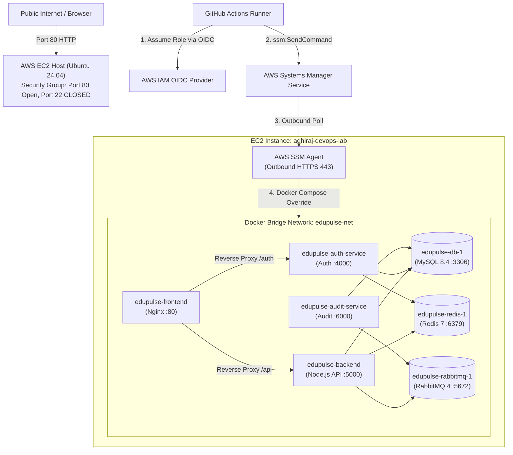
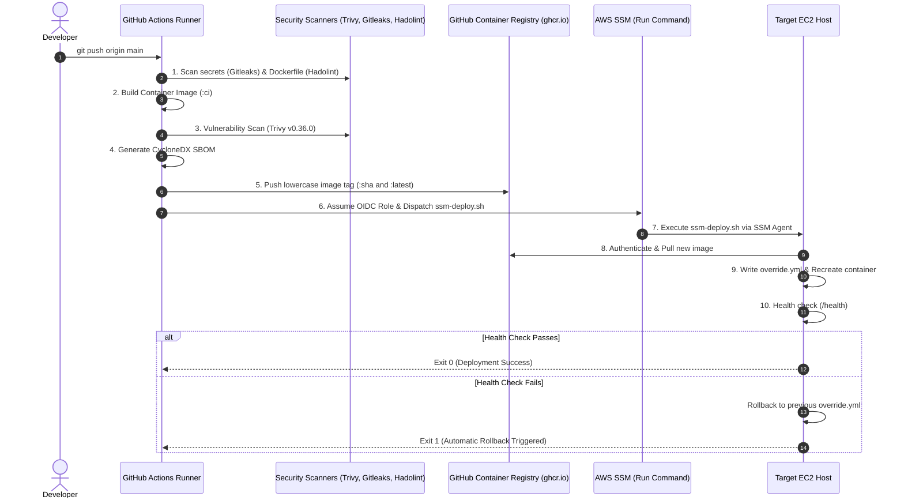

# EduPulse DevSecOps & GitOps Handbook: Multi-Repo Microservices on AWS EC2 (Zero-SSH)

> **Audience:** DevOps Engineers, Cloud Learners, and System Administrators  
> **Architecture:** Multi-Repo Microservices (7 Services) + AWS EC2 + GitHub Actions CI/CD  
> **Security Model:** Zero-Trust / Keyless (Strictly No SSH keys, No open port 22, AWS OIDC + AWS Systems Manager)

---

## Table of Contents
1. [Introduction & Design Philosophy](#1-introduction--design-philosophy)
2. [High-Level Architecture & Topology](#2-high-level-architecture--topology)
3. [Prerequisites & Workstation Setup](#3-prerequisites--workstation-setup)
4. [Step 1: AWS Foundation & Keyless Security Setup](#step-1-aws-foundation--keyless-security-setup)
5. [Step 2: Platform & Shared Data Infrastructure (`edupulse-platform`)](#step-2-platform--shared-data-infrastructure-edupulse-platform)
6. [Step 3: Microservice Repositories & DevSecOps CI/CD Pipelines](#step-3-microservice-repositories--devsecops-cicd-pipelines)
7. [Step 4: Connecting to the Server (AWS SSM Session Manager)](#step-4-connecting-to-the-server-aws-ssm-session-manager)
8. [Step 5: Verifying & Smoke-Testing the Deployment](#step-5-verifying--smoke-testing-the-deployment)
9. [Step 6: The "Troubleshooting Hall of Fame" (Real Bugs & Fixes)](#step-6-the-troubleshooting-hall-of-fame-real-bugs--fixes)
10. [Step 7: Student Cheatsheet & Quick Commands](#step-7-student-cheatsheet--quick-commands)

---

## 1. Introduction & Design Philosophy

When deploying modern microservices to cloud virtual machines (like AWS EC2), traditional tutorials instruct students to:
1. Generate an SSH key pair (`ssh-keygen`).
2. Open **Port 22** to the entire world (`0.0.0.0/0`) in AWS Security Groups.
3. Paste their private SSH key and long-lived AWS Access Keys into GitHub Actions Secrets.
4. SSH into the server from CI/CD to run commands.

### Why We Abandoned That Approach:
- **Security Vulnerability:** Exposing port 22 invites continuous automated brute-force bot attacks.
- **Credential Leakage:** Storing static SSH keys or AWS IAM Secret Access Keys in GitHub Secrets creates long-lived credentials that can be leaked or misconfigured.
- **Firewall & IP Issues:** GitHub Actions runners have dynamic IP addresses; you cannot whitelist a single IP without complex IP synchronizer scripts.
- **Audit Deficits:** Plain SSH gives minimal centralized auditing of who ran what command.

### The Modern Enterprise Solution: AWS Systems Manager (SSM) + GitHub Actions OIDC
In this project, we implement a **zero-trust, keyless DevSecOps architecture**:
- **No Open Port 22:** The EC2 Security Group opens **only HTTP (Port 80)**.
- **No Stored AWS Credentials:** GitHub Actions authenticates using OpenID Connect (OIDC) to exchange short-lived cryptographic tokens for temporary AWS STS credentials.
- **Outbound Agent Execution:** The AWS SSM Agent runs inside the EC2 instance, continuously polling AWS SSM endpoints over outbound HTTPS (443). To execute commands or open a shell, AWS SSM sends commands to the agent without requiring any inbound open ports on your server.
- **Microservice Isolation (Compose Overrides):** Instead of redeploying the whole system, each microservice updates only its own container using dynamic Docker Compose overrides (`/var/lib/gha-deploy/<service>.override.yml`).

---

## 2. High-Level Architecture & Topology

The EduPulse platform is split across **5 independent GitHub repositories**:
1. **`edupulse-platform`**: The infrastructure GitOps repository. Owns the base `docker-compose.yml`, shared database initialization scripts (`db/init.sh`), RabbitMQ configs, and data stores.
2. **`edupulse-auth-service`**: Authentication microservice (Port 4000).
3. **`edupulse-backend`**: Core API backend (Port 5000).
4. **`edupulse-audit-service`**: Audit logging microservice (Port 6000).
5. **`edupulse-frontend`**: React/SPA frontend served via Nginx reverse proxy (Port 80).

### Infrastructure Topology



---

## 3. Prerequisites & Workstation Setup

Before setting up the project, install the following tools on your local development machine:

### 1. AWS CLI v2
- **macOS:** `brew install awscli`
- **Linux:** `sudo apt-get install awscli` or follow the official AWS bundle installer.
- **Windows:** Download the AWS CLI MSI installer.

### 2. AWS Session Manager Plugin (Essential for SSH-free terminal access!)
The Session Manager plugin extends the AWS CLI to enable interactive shell sessions:
- **macOS:**
  ```bash
  brew install --cask session-manager-plugin
  ```
- **Ubuntu/Debian:**
  ```bash
  curl "https://s3.amazonaws.com/session-manager-downloads/plugin/latest/ubuntu_64bit/session-manager-plugin.deb" -o "session-manager-plugin.deb"
  sudo dpkg -i session-manager-plugin.deb
  ```
- **Verify installation:**
  ```bash
  session-manager-plugin
  # Output should state: The Session Manager plugin is installed successfully.
  ```

### 3. Git & GitHub Account
Ensure you have Git installed and access to your GitHub account with permission to create repositories and push packages to the GitHub Container Registry (GHCR).

---

## 4. Step 1: AWS Foundation & Keyless Security Setup

To replicate this zero-SSH architecture, you need 4 primary AWS configurations:

### 1.1 EC2 Instance & Security Group
1. Launch an EC2 instance:
   - **OS:** Ubuntu 24.04 LTS (or 22.04 LTS).
   - **Instance Type:** `t3.medium` (2 vCPU, 4GB RAM recommended for running all 7 containers).
   - **Storage:** 30 GB gp3 SSD.
2. Configure the Security Group:
   - **Inbound Rules:**
     - Type: `HTTP`, Port: `80`, Source: `0.0.0.0/0` (Allows public access to the web UI).
     - **DO NOT ADD PORT 22 (SSH).** Leave port 22 closed!
   - **Outbound Rules:**
     - All Traffic to `0.0.0.0/0` (Allows Docker to pull images and SSM Agent to communicate with AWS).

### 1.2 EC2 IAM Role (SSM Instance Profile)
The EC2 instance requires permissions to talk to the AWS Systems Manager service.
1. Create an IAM Role named `EC2-SSM-Role` with trust entity `ec2.amazonaws.com`.
2. Attach the AWS-managed policy:
   - `AmazonSSMManagedInstanceCore`
3. Attach this role to your EC2 instance:
   - EC2 Console -> Select Instance -> **Actions** -> **Security** -> **Modify IAM Role** -> Select `EC2-SSM-Role`.

### 1.3 AWS OIDC Identity Provider (GitHub Actions)
Allow GitHub Actions to request temporary AWS credentials without passwords:
1. Go to **AWS IAM Console** -> **Identity Providers** -> **Add Provider**.
2. Select **OpenID Connect**.
3. **Provider URL:** `https://token.actions.githubusercontent.com`
4. **Audience:** `sts.amazonaws.com`
5. Click **Add provider**.

### 1.4 GitHub Actions Deployment IAM Role
Create the IAM Role assumed by GitHub Actions:
- **Role Name:** `GitHubActions-devops-ec2ssm-role`
- **Trust Policy:**
  > [!IMPORTANT]
  > GitHub Actions sends claims formatted with internal account identifiers (e.g., `repo:Org@12345/repo-name@67890:ref:...`). Using strict equality matches can cause `AccessDenied`. Use string wildcards (`StringLike`) as shown below:

```json
{
  "Version": "2012-10-17",
  "Statement": [
    {
      "Effect": "Allow",
      "Principal": {
        "Federated": "arn:aws:iam::<YOUR_ACCOUNT_ID>:oidc-provider/token.actions.githubusercontent.com"
      },
      "Action": "sts:AssumeRoleWithWebIdentity",
      "Condition": {
        "StringEquals": {
          "token.actions.githubusercontent.com:aud": "sts.amazonaws.com"
        },
        "StringLike": {
          "token.actions.githubusercontent.com:sub": [
            "repo:*edupulse-*:*"
          ]
        }
      }
    }
  ]
}
```

- **Permissions Policy:** Attach an inline policy allowing GitHub Actions to invoke SSM Run Command on your EC2 instance:
```json
{
  "Version": "2012-10-17",
  "Statement": [
    {
      "Effect": "Allow",
      "Action": [
        "ssm:SendCommand",
        "ssm:GetCommandInvocation",
        "ssm:ListCommandInvocations",
        "ssm:DescribeInstanceInformation"
      ],
      "Resource": "*"
    }
  ]
}
```

### 1.5 SSM Parameter Store for GHCR Pull Credentials
Because microservice container images are published to private/authenticated GitHub Container Registries (`ghcr.io`), the EC2 host needs credentials to pull images. Store them securely in AWS Systems Manager Parameter Store:

```bash
aws ssm put-parameter \
  --name "/devsecops-demo/prod/ghcr_pull_user" \
  --value "<YOUR_GITHUB_USERNAME>" \
  --type "String" \
  --overwrite

aws ssm put-parameter \
  --name "/devsecops-demo/prod/ghcr_pull_token" \
  --value "<YOUR_GITHUB_PAT_TOKEN_WITH_READ_PACKAGES>" \
  --type "SecureString" \
  --overwrite
```

---

## 5. Step 2: Platform & Shared Data Infrastructure (`edupulse-platform`)

The `edupulse-platform` repository acts as the **single source of truth** for the shared data tier.

### 2.1 Repository Directory Structure
```
edupulse-platform/
├── .github/
│   └── workflows/
│       ├── infra.yml             # Deploys data-tier & base compose via SSM
│       └── terraform.yml         # (Optional/Commented out when using existing EC2)
├── deploy/
│   └── docker-compose.yml        # Base stack (db, redis, rabbitmq, service stubs)
├── infra/
│   ├── db/
│   │   └── init.sh               # MySQL schemas & users (student_db, audit_db)
│   └── rabbitmq/
│       └── rabbitmq.conf         # RabbitMQ tuning & limits
└── scripts/
    └── ssm-run-platform.sh       # Packages configs and ships to EC2 over SSM
```

### 2.2 Database Initialization (`infra/db/init.sh`)
When MySQL starts for the first time, it executes scripts in `/docker-entrypoint-initdb.d/`. Ensure both databases and users are provisioned:

```sql
-- Create student_db for backend and auth-service
CREATE DATABASE IF NOT EXISTS student_db;
CREATE USER IF NOT EXISTS 'student'@'%' IDENTIFIED BY '${MYSQL_PASSWORD}';
GRANT ALL PRIVILEGES ON student_db.* TO 'student'@'%';

-- Create audit_db for audit-service
CREATE DATABASE IF NOT EXISTS audit_db;
CREATE USER IF NOT EXISTS 'audit'@'%' IDENTIFIED BY '${AUDIT_DB_PASSWORD}';
GRANT ALL PRIVILEGES ON audit_db.* TO 'audit'@'%';

FLUSH PRIVILEGES;
```

### 2.3 How Platform Deployment Works
When a commit is pushed to `main` in `edupulse-platform`:
1. The GitHub Actions runner assumes the IAM OIDC Role.
2. It executes `bash scripts/ssm-run-platform.sh`.
3. The script tars `docker-compose.yml`, `init.sh`, and `rabbitmq.conf`, encodes them in base64, and sends an `AWS-RunShellScript` command via AWS SSM.
4. On the EC2 host:
   - The archive is extracted to `/opt/edupulse`.
   - If `/opt/edupulse/.env` does not exist, strong random passwords are auto-generated.
   - It runs `docker compose up -d db redis rabbitmq`.
   - It loops until `db`, `redis`, and `rabbitmq` all report `(healthy)`.

---

## 6. Step 3: Microservice Repositories & DevSecOps CI/CD Pipelines

Each microservice (`auth-service`, `backend`, `audit-service`, `frontend`) maintains its own independent repository and CI/CD workflow in `.github/workflows/ci-cd.yml`.

### 6.1 DevSecOps CI/CD Pipeline Stages



### 6.2 Key DevSecOps Workflow Features
1. **Pinned Trivy Action:** Uses `aquasecurity/trivy-action@v0.36.0` to avoid broken upstream tags.
2. **Lowercase Image Tags:** GitHub repository paths may contain uppercase letters (e.g. `Adhiraj1212`), which Docker strictly rejects. The workflow converts the path to lowercase before pushing:
   ```bash
   REPO_LOWER=$(echo "${{ github.repository }}" | tr '[:upper:]' '[:lower:]')
   IMAGE="ghcr.io/${REPO_LOWER}"
   ```
3. **Software Bill of Materials (SBOM):** Generates a machine-readable inventory of software components using CycloneDX and attaches it as a build artifact.

### 6.3 The Dynamic Override Strategy (Zero-Downtime Updates)
Instead of re-running the entire `docker-compose.yml` (which could restart the database or other microservices), each service deploys using a **Docker Compose Override**:
- Platform base configuration: `/opt/edupulse/docker-compose.yml`
- Service-specific override: `/var/lib/gha-deploy/<service>.override.yml`

When `ssm-deploy.sh` executes:
```bash
# 1. Pull the new image
docker pull "$IMAGE_REF"

# 2. Backup current healthy override
cp /var/lib/gha-deploy/$SERVICE_NAME.override.yml /var/lib/gha-deploy/$SERVICE_NAME.override.yml.bak

# 3. Write new override pointing to the new image SHA
cat <<EOF > /var/lib/gha-deploy/$SERVICE_NAME.override.yml
services:
  $SERVICE_NAME:
    image: $IMAGE_REF
EOF

# 4. Recreate ONLY this service container
cd /opt/edupulse
docker compose -f docker-compose.yml -f /var/lib/gha-deploy/$SERVICE_NAME.override.yml up -d --no-deps $SERVICE_NAME

# 5. Health Check Verification Loop
# Checks container health up to 30 times. If healthy: SUCCESS.
# If it fails or crashes: Automatically restores .override.yml.bak and rolls back!
```

---

## 7. Step 4: Connecting to the Server (AWS SSM Session Manager)

You do **NOT** need an SSH key, an SSH client, or an open port 22 to access your EC2 instance terminal.

### Connecting from Your Local Workstation
From your local terminal (macOS, Linux, or Windows with AWS CLI and Session Manager Plugin installed):

```bash
aws ssm start-session --target <YOUR_INSTANCE_ID> --region <YOUR_AWS_REGION>
```

*(e.g., `aws ssm start-session --target i-0123456789abcdef0 --region eu-north-1`)*

### Privilege Escalation
AWS SSM logs you in as the default service account: `ssm-user`. To run Docker commands or inspect system files, switch to root:

```bash
sudo su -
```

> [!WARNING]
> **Common Student Error:** Do NOT run `aws ssm start-session` from *inside* an existing EC2 session. The instance's attached IAM role (`EC2-SSM-Role`) is designed to *receive* commands from AWS SSM, not to initiate remote sessions into itself. It will return `AccessDeniedException`. Always run `aws ssm start-session` from your **local computer's terminal**.

---

## 8. Step 5: Verifying & Smoke-Testing the Deployment

Once all CI/CD pipelines finish, verify the health of the entire system.

### 8.1 Checking Containers on the EC2 Host
Run via SSM Session Manager:
```bash
docker ps --format "table {{.Names}}\t{{.Status}}\t{{.Ports}}"
```

**Expected Healthy Output:**
```
NAMES                      STATUS                    PORTS
edupulse-frontend-1        Up 10 minutes (healthy)   0.0.0.0:80->8080/tcp, [::]:80->8080/tcp
edupulse-audit-service-1   Up 5 minutes (healthy)    127.0.0.1:6000->6000/tcp
edupulse-backend-1         Up 10 minutes (healthy)   127.0.0.1:5000->5000/tcp
edupulse-auth-service-1    Up 10 minutes (healthy)   127.0.0.1:4000->4000/tcp
edupulse-redis-1           Up 7 hours (healthy)      127.0.0.1:6379->6379/tcp
edupulse-rabbitmq-1        Up 7 hours (healthy)      127.0.0.1:5672->5672/tcp
edupulse-db-1              Up 7 hours (healthy)      127.0.0.1:3306->3306/tcp
```

### 8.2 Verifying Internal Health Check Endpoints
On the EC2 host:
```bash
# Frontend
curl -I http://localhost:8080/

# Backend API
curl -s http://localhost:5000/health

# Auth Service
curl -s http://localhost:4000/healthz

# Audit Service
curl -s http://localhost:6000/health
```

### 8.3 Accessing the Web Application
In your local browser, navigate to the public IP of your EC2 instance:
```
http://<YOUR_EC2_PUBLIC_IP>
```

**Test Credentials:**
| Role | Username | Password |
| :--- | :--- | :--- |
| **Admin** | `admin` | `administrator` |
| **Student** | `student` | `student123` |

---

## 9. Step 6: The "Troubleshooting Hall of Fame" (Real Bugs & Fixes)

During real-world setup, pipelines inevitably encounter edge cases. Here are the exact bugs encountered in this project, why they occurred, and how to resolve them:

### Bug 1: The Deleted Action Tag (`trivy-action@v0.28.0`)
- **Error:** `Unable to resolve action aquasecurity/trivy-action@v0.28.0, unable to find version v0.2.1`
- **Cause:** `aquasecurity/trivy-action@v0.28.0` internally referenced an unpinned upstream action (`aquasecurity/setup-trivy@v0.2.1`). The upstream authors deleted that version tag, causing older action versions to fail during workflow resolution.
- **Solution:** Upgrade to `aquasecurity/trivy-action@v0.36.0`, which uses immutable commit SHAs.

### Bug 2: Docker Upper-Case Repository Rejection
- **Error:** `invalid reference format: repository name (Adhiraj1212/edupulse-backend) must be lowercase`
- **Cause:** The Open Containers Initiative (OCI) and Docker specifications strictly forbid uppercase letters in repository image names. If your GitHub username has uppercase letters (e.g., `Adhiraj1212`), passing `${{ github.repository }}` fails.
- **Solution:** Convert the repository name to lowercase using `tr` before building and pushing:
  ```bash
  REPO_LOWER=$(echo "${{ github.repository }}" | tr '[:upper:]' '[:lower:]')
  IMAGE="ghcr.io/${REPO_LOWER}"
  ```

### Bug 3: SSM Deploy "Bad Image Reference"
- **Error:** `bad image reference: frontend@sha256:... Error: Process completed with exit code 2`
- **Cause:** Using `docker inspect --format '{{index .RepoDigests 0}}'` extracted an image reference that omitted the registry domain (`frontend@...` instead of `ghcr.io/adhiraj1212/edupulse-frontend:...`).
- **Solution:** Pass the explicitly tagged image reference directly from GitHub Actions:
  ```bash
  IMAGE_REF="${IMAGE}:${GITHUB_SHA}"
  ```

### Bug 4: GitHub Actions `concurrency` Context Limitation
- **Error:** Workflow syntax validation failure (`jobs: []`) or unexpected workflow refusal.
- **Cause:** GitHub Actions does not permit `${{ env.* }}` expressions inside the top-level `concurrency: group:` block because environment variables are not yet evaluated during workflow parsing.
- **Solution:** Hardcode static strings for concurrency groups:
  ```yaml
  concurrency:
    group: deploy-backend
    cancel-in-progress: false
  ```

### Bug 5: GitHub Actions OIDC Subject Mismatch (`@*` Organization IDs)
- **Error:** `An error occurred (AccessDeniedWithAuth) when calling the AssumeRoleWithWebIdentity operation`
- **Cause:** GitHub Actions OIDC subjects historically looked like `repo:owner/repo:ref:...`. In newer GitHub deployments, the format includes internal numeric IDs: `repo:owner@12345/repo@67890:ref:...`. Strict string matching causes AWS IAM to reject the token.
- **Solution:** Use wildcards in the IAM Role Trust Policy `StringLike` statement:
  ```json
  "StringLike": {
    "token.actions.githubusercontent.com:sub": [
      "repo:*edupulse-*:*"
    ]
  }
  ```

### Bug 6: MySQL User Network Privileges (`'audit'@'%'`)
- **Error:** `Waiting for database: Access denied for user 'audit'@'172.20.0.7'`
- **Cause:** Microservices run in separate Docker containers connected via the bridge network `edupulse-net`. Their connections come from internal IP addresses (e.g. `172.20.0.7`). If a user is created only for `localhost` (`'audit'@'localhost'`), MySQL rejects connections coming across the Docker bridge.
- **Solution:** Always create database users with wildcard host permissions:
  ```sql
  CREATE USER IF NOT EXISTS 'audit'@'%' IDENTIFIED BY 'password';
  GRANT ALL PRIVILEGES ON audit_db.* TO 'audit'@'%';
  FLUSH PRIVILEGES;
  ```

---

## 10. Step 7: Student Cheatsheet & Quick Commands

### Local Workstation Commands
```bash
# Connect to EC2 instance terminal (Zero SSH keys needed)
aws ssm start-session --target <INSTANCE_ID> --region <REGION>

# Check if SSM agent is online for your instance
aws ssm describe-instance-information --output table
```

### On the EC2 Host (via SSM Session)
```bash
# Switch to root
sudo su -

# View all running EduPulse containers and their health
docker ps --format "table {{.Names}}\t{{.Status}}\t{{.Ports}}"

# Inspect logs of a specific microservice
docker logs -f --tail 50 edupulse-backend-1
docker logs -f --tail 50 edupulse-audit-service-1

# View the deployment override for a microservice
cat /var/lib/gha-deploy/backend.override.yml

# View deployment history and timestamps
cat /var/lib/gha-deploy/*.last-deployed

# Restart the shared data tier
cd /opt/edupulse && docker compose restart
```

### Pushing Code to Trigger Independent Microservice Deployments
```bash
# Push platform infrastructure changes
git -C edupulse-platform add -A && git -C edupulse-platform commit -m "update infra" && git -C edupulse-platform push

# Push backend changes
git -C edupulse-backend add -A && git -C edupulse-backend commit -m "update backend" && git -C edupulse-backend push

# Push frontend changes
git -C edupulse-frontend add -A && git -C edupulse-frontend commit -m "update frontend" && git -C edupulse-frontend push
```

---

## Summary Deployment Checklist

- [x] **No SSH Keys:** Port 22 is closed; all connections go through AWS Systems Manager Session Manager.
- [x] **No Static AWS Secrets:** GitHub Actions assumes temporary credentials using OIDC.
- [x] **Shift-Left DevSecOps:** Gitleaks scans secrets, Hadolint lints Dockerfiles, Trivy scans vulnerabilities, and CycloneDX generates SBOMs.
- [x] **Independent Microservice Deployments:** Microservices deploy via Docker Compose overrides without restarting other containers.
- [x] **Automated Health Checks & Rollbacks:** Broken containers trigger an immediate automatic rollback to the previous healthy container image.
